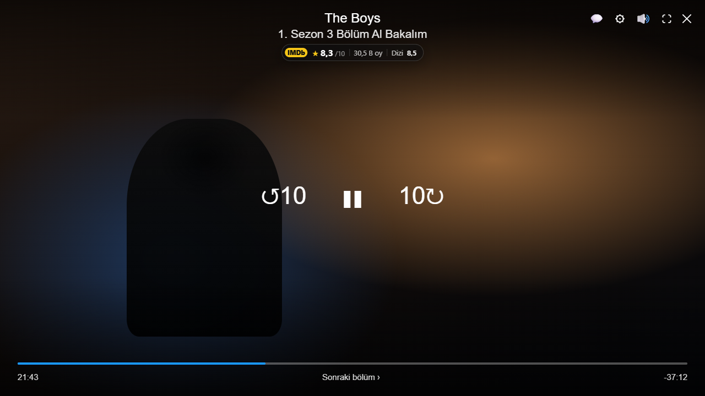
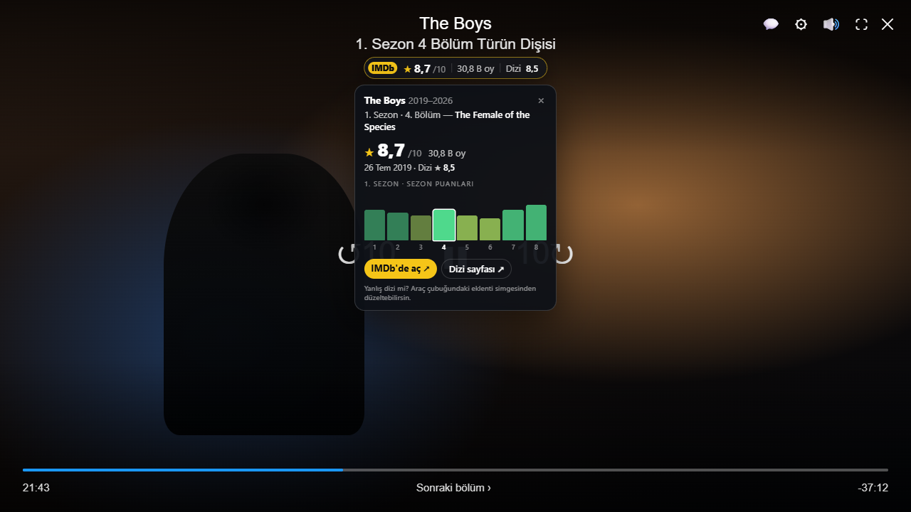
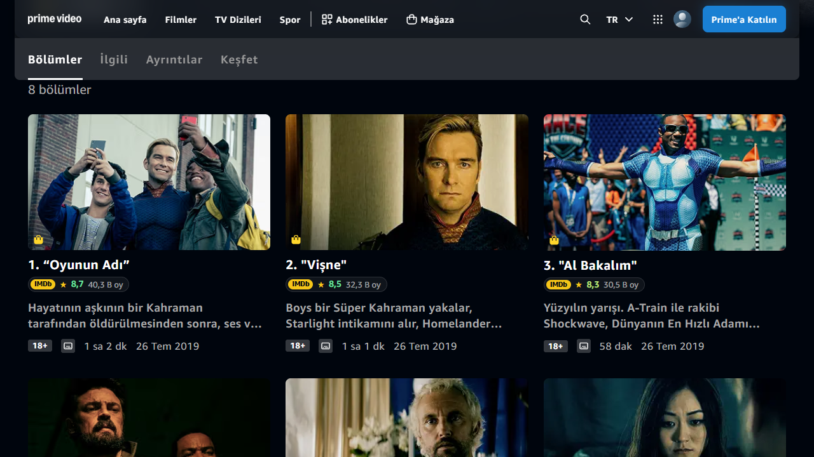
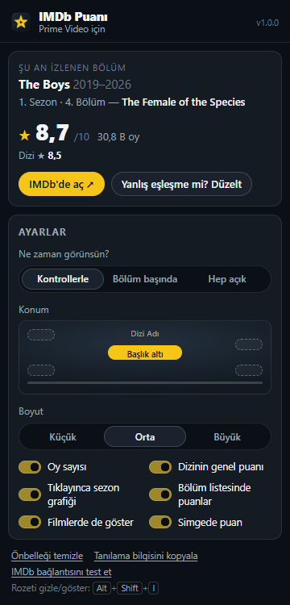

# Prime Video IMDb Puanı

Prime Video'da izlediğin bölümün IMDb puanını oynatıcının üstünde, Prime'ın kendi başlığının hemen altında gösteren kişisel tarayıcı eklentisi. Brave, Chrome, Edge gibi Chromium tabanlı tarayıcılarda çalışır.



## Neler yapıyor?

- **Oynatıcıda bölüm puanı:** `★ 8,3 /10 · 30 B oy · Dizi 8,5`. Varsayılan olarak Prime'ın kontrolleriyle birlikte belirir ve kaybolur, yani izlerken ekranda bir şey kalmaz.
- **Rozete tıklayınca panel:** bölümün IMDb adı, yayın tarihi, dizinin genel puanı ve sezondaki tüm bölümlerin **mini puan grafiği**. Şu anki bölüm vurgulanır; sonraki bölümlerin adları spoiler olmasın diye gizlenir. "IMDb'de aç" sayfayı arka plan sekmesinde açar, tam ekrandan çıkarmaz.
- **Dizi sayfasındaki bölüm listesinde** her bölümün altında IMDb puanı ve oy sayısı.
- **Filmlerde** filmin puanı.
- **Araç çubuğu simgesinde** o sekmedeki bölümün puanı.
- Bölüm otomatik değişince (sonraki bölüm) puan da kendiliğinden güncellenir. Tam ekranda da çalışır.





## Brave'e kurulum

1. Adres çubuğuna `brave://extensions` yaz.
2. Sağ üstteki **Geliştirici modu**nu aç.
3. **Paketlenmemiş öğe yükle**'ye tıkla ve bu klasördeki **`extension`** klasörünü seç:
   `C:\Users\anils\Desktop\Tarayıcı eklentisi\extension`
4. İsteğe bağlı: araç çubuğundaki yapboz simgesinden eklentiyi **sabitle**. Simgedeki puan ve ayarlar oradan görünür.

Açık bir Prime Video sekmen varsa sayfayı yenilemene gerek yok; eklenti kurulduğu anda o sekmede de çalışmaya başlar.

## Kullanım ve ayarlar

Araç çubuğundaki simgeye tıkla:



| Ayar | Seçenekler |
|---|---|
| Ne zaman görünsün? | **Kontrollerle** (varsayılan) · **Bölüm başında** (yeni bölümde 10 sn, sonra kontrollerle) · **Hep açık** |
| Konum | **Başlığın altı** (varsayılan) · sol üst · sağ üst · sol alt · sağ alt |
| Boyut | Küçük · Orta · Büyük |
| Göstergeler | Oy sayısı, dizinin genel puanı, tıklayınca sezon grafiği, bölüm listesinde puanlar, filmlerde göster, simgede puan |

- **Kısayol:** `Alt+Shift+I` rozeti gizler ya da gösterir. `brave://extensions/shortcuts` adresinden değiştirebilirsin.
- **Yanlış dizi mi eşleşti?** Popup'ta **Yanlış eşleşme mi? Düzelt** düğmesine bas, IMDb'de ara ve doğrusunu **Seç**. Seçimin o dizi adı için kalıcı olarak hatırlanır. **Otomatik eşleşmeye dön** ile geri alabilirsin. Örneğin aynı adlı iki "The Grand Tour" var: 2016 ve 2026.

## Nasıl çalışıyor?

1. Prime oynatıcısındaki dizi adını (`atvwebplayersdk-title-text`) ve bölüm satırını (`atvwebplayersdk-subtitle-text`) okur. Türkçe arayüzdeki bölüm satırı "1. Sezon 3 Bölüm Bölüm Adı" biçimindedir. Bu kalıp, Prime'ın kendi dil dosyalarından alınan **34 dil** için tanımlı.
2. IMDb'de diziyi arar. Türkçe adlar da bulunur; örneğin "Yüzüklerin Efendisi: Güç Yüzükleri". Ardından o sezonun bütün bölümlerini tek istekte çeker.
3. Doğru diziyi; adın benzerliği, popülerlik, yıl, Prime'ın gösterdiği dizi puanı ve "bu sezonda bu bölüm var mı" kontrolüyle seçer.
4. Sonuçlar önbelleğe alınır: sezon verisi 12 saat (yeni yayınlanan sezonlarda 3 saat), eşleşmeler 30 gün. Aynı sezonun sonraki bölümleri anında gelir.

API anahtarı gerekmez. Eklenti yalnızca dizi/film adlarını IMDb'ye gönderir; başka hiçbir yere veri göndermez, iz sürmez. Popup'taki elle düzeltme aramasında sonuçların küçük afişleri IMDb'nin görsel sunucusundan (`m.media-amazon.com`) yüklenir. Eklentinin erişim izni yalnızca `primevideo.com` ve IMDb adresleriyle sınırlıdır.

> IMDb verileri yalnızca kişisel, ticari olmayan kullanım içindir. Bu eklenti kişisel kullanım için yazıldı; mağazada yayınlanmamalıdır.

## Sorun giderme

- **Rozet çıkmıyor:** Popup'ı aç. "Şu an izlenen bölüm" kartı ne algılandığını gösterir. **Tanılama bilgisini kopyala**; ham başlık, bölüm satırı, ayrıştırma sonucu ve eşleşme adaylarını panoya kopyalar.
- **"IMDb'ye ulaşılamadı":** Popup'taki **IMDb bağlantısını test et** düğmesine bas. Rozete tıklamak da yeniden dener.
- **Puan eski görünüyor:** **Önbelleği temizle**.
- **Bölüm IMDb'de yok:** Çok yeni bölümlerde ya da Prime ile IMDb'nin bölüm numaralandırması farklı olduğunda olur. Bu durumda dizinin genel puanı gösterilir.

## Bilinen sınırlamalar

- Prime oynatıcısı giriş ve DRM gerektirdiği için otomatik testlerde gerçek oynatıcı yerine onun DOM yapısının birebir kopyası kullanılır. Bu yapı, Prime'ın canlı oynatıcı kodundan çıkarıldı. Dizi sayfasındaki bölüm listesi ise gerçek Prime sitesinde test edilir.
- Prime ile IMDb'nin bölüm numaralandırması farklı olan dizilerde (bazı animeler, bölünmüş sezonlar) bölüm bulunamayabilir. Bu durumda dizinin genel puanı gösterilir; İngilizce arayüzde bölüm adıyla eşleştirme de denenir.
- Aynı adlı dizilerde Prime'ın dizi sayfasındaki yıl ve IMDb puanı ipucu olarak kullanılır. "İzlemeye devam et"ten açılınca bu ipuçları olmayabilir; yanlış eşleşmeyi popup'tan bir kez düzeltmen yeter.
- IMDb'nin bu uç noktaları resmi bir API değildir; değişirse eklenti hata durumunu gösterir.

## Geliştirme

Gereksinim: Node.js 22+. Testler **yalnızca görünmez (headless) Chrome for Testing** ile çalışır; tarayıcı penceresi açılmaz, kişisel Brave/Chrome profiline dokunulmaz.

```bash
npm install
npx puppeteer browsers install chrome   # test tarayıcısı .cache/ klasörüne iner
npm run check        # sözdizimi + manifest + dosya bütünlüğü
npm test             # birim testleri (139 test, bağımlılıksız, node:test)
npm run test:live    # canlı IMDb entegrasyon testleri
npm run test:e2e     # uçtan uca (22 senaryo): headless Chrome + eklenti + Prime oynatıcı kopyası + gerçek Prime dizi sayfası
npm run sync:prime   # Prime'ın dil dosyalarından bölüm kalıplarını yeniden üretir, sınıf adlarını doğrular
npm run icons        # simgeleri yeniden çizer
```

Klasörler:

```
extension/          Tarayıcıya yüklenen eklenti (build adımı yok)
  background.js     IMDb istekleri, önbellek, simge rozeti
  shared/           Ortak modüller (ayrıştırma, eşleştirme, IMDb istemcisi, önbellek, ayarlar)
  content/          Prime Video adaptörü, oynatıcı rozeti, bölüm listesi, kontrolcü
  popup/            Ayarlar ve elle düzeltme
tests/              unit/ · live/ · e2e/ · fixtures/ (Prime oynatıcısının DOM kopyası)
tools/              Prime kalıp senkronu, simge üretimi, statik kontrol
```

Prime arayüzünü değiştirirse önce `npm run sync:prime` çalıştır. Sınıf adları değişmişse bunu raporlar.
