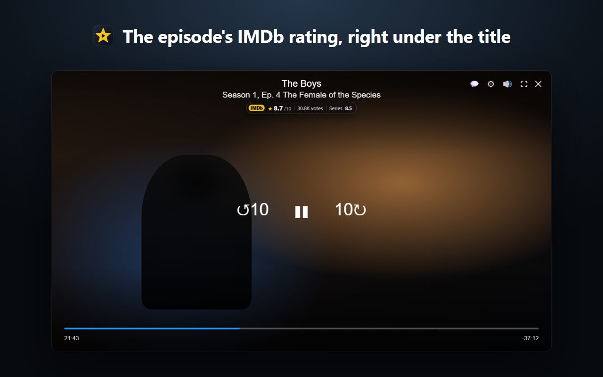
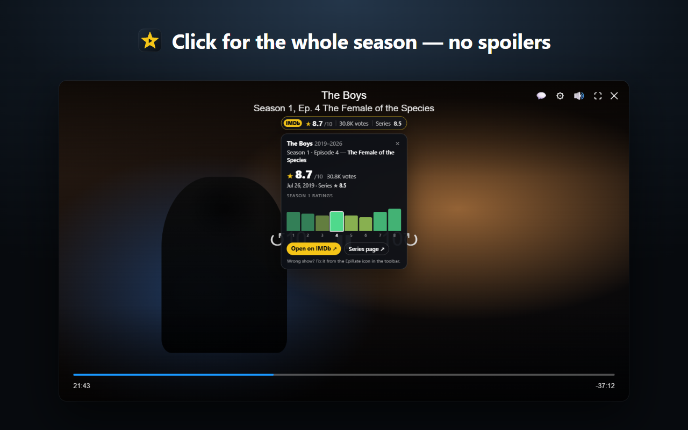
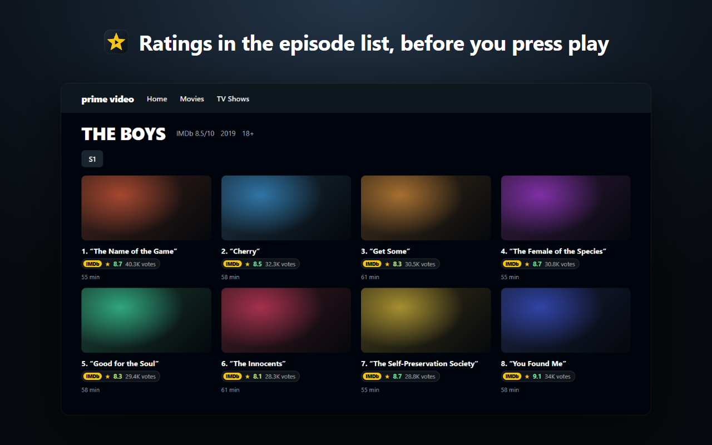

# EpiRate

**IMDb episode ratings while you watch.** A browser extension for Prime Video. It works in Chrome, Brave, Edge and other Chromium-based browsers.

[Türkçe](README.tr.md) · [Privacy](PRIVACY.md) · [Report a bug](https://github.com/Guidin9/epirate/issues)



## Features

- **The episode's rating in the player:** `★ 8.3/10 · 30.5K votes · Series 8.5`. It sits under Prime's own title and appears and fades with the player controls, so nothing covers the picture while you watch.
- **Season at a glance:** click the badge to see a mini chart of every episode's rating. Titles of upcoming episodes stay hidden, so there are no spoilers. "Open on IMDb" opens a background tab and doesn't exit fullscreen.
- **Episode list ratings:** on series pages, every episode shows its rating and vote count before you press play.
- **Movies too,** plus the current rating on the toolbar icon.
- **Smart matching:**
  - Finds the right show even with localized titles, e.g. "Yüzüklerin Efendisi: Güç Yüzükleri" → *The Rings of Power*.
  - Tells same-named shows apart.
  - Wrong match? Fix it in two clicks; your choice is remembered.
- **Your way:**
  - When it shows: with the controls, at episode start, or always.
  - Position (under the title or any corner) and size.
  - <kbd>Alt</kbd>+<kbd>Shift</kbd>+<kbd>I</kbd> hides it.
- **Languages:**
  - Interface in 12 languages: English, Türkçe, Deutsch, Español, Français, Italiano, Português (BR), Polski, Nederlands, 日本語, हिन्दी, العربية.
  - Reads Prime Video's episode line in 34 languages.





## Install

- **Chrome Web Store:** coming soon.
- **Manual (developer mode):**
  1. Download or clone this repository.
  2. Open `chrome://extensions` (Brave: `brave://extensions`) and turn on **Developer mode**.
  3. Click **Load unpacked** and select the `extension` folder.

  If a Prime Video tab is already open, there's no need to reload it. EpiRate starts there right away.

## Roadmap

Support for **more streaming platforms** is coming in upcoming versions.

## Feedback & bug reports

- In the extension: open the popup and click **Report a bug / Contact**. It prepares an email with optional technical details. Nothing is sent automatically.
- Email: [contact@mertdemirdoven.me](mailto:contact@mertdemirdoven.me)
- GitHub: [issues](https://github.com/Guidin9/epirate/issues)

## Privacy

- No account, no ads, no tracking.
- EpiRate only sends the title you're watching to IMDb to look up its rating, and caches results on your device.

Details: [PRIVACY.md](PRIVACY.md)

## Development

Requires Node.js 22+. Tests run **only in a headless Chrome for Testing** with a temporary profile, so your own browser is never touched.

```bash
npm install
npx puppeteer browsers install chrome   # test browser goes into .cache/
npm run check        # syntax, manifest, locale files
npm test             # unit tests (node:test, no dependencies)
npm run test:live    # live IMDb integration tests
npm run test:e2e     # end-to-end: headless Chrome + extension + Prime player replica + real Prime series page
npm run package      # Chrome Web Store zip → dist/
npm run locales      # rebuild _locales from tools/i18n/messages.mjs
npm run store:assets # store screenshots (12 languages) and promo tiles
npm run store:texts  # store listing texts (12 languages)
npm run sync:prime   # refresh Prime's episode-line formats and verify its player class names
```

| Folder | Contents |
|---|---|
| `extension/` | The extension itself; no build step. |
| `extension/background.js` | IMDb requests, cache, toolbar badge. |
| `extension/shared/` | Shared modules: parsing, matching, IMDb client, cache, settings, i18n. |
| `extension/content/` | Prime Video adapter, player badge, episode list, controller. |
| `extension/popup/` | Settings, manual match fixing, bug report. |
| `tests/` | `unit/`, `live/`, `e2e/`, `fixtures/` (Prime page replicas). |
| `tools/` | Locale build, Prime format sync, packaging, store assets. |
| `store/` | Chrome Web Store texts, screenshots, upload guide. |

## Disclaimer

EpiRate is an independent project and is not affiliated with, endorsed or sponsored by IMDb or Amazon. IMDb and Prime Video are trademarks of their respective owners. Rating data comes from IMDb.
