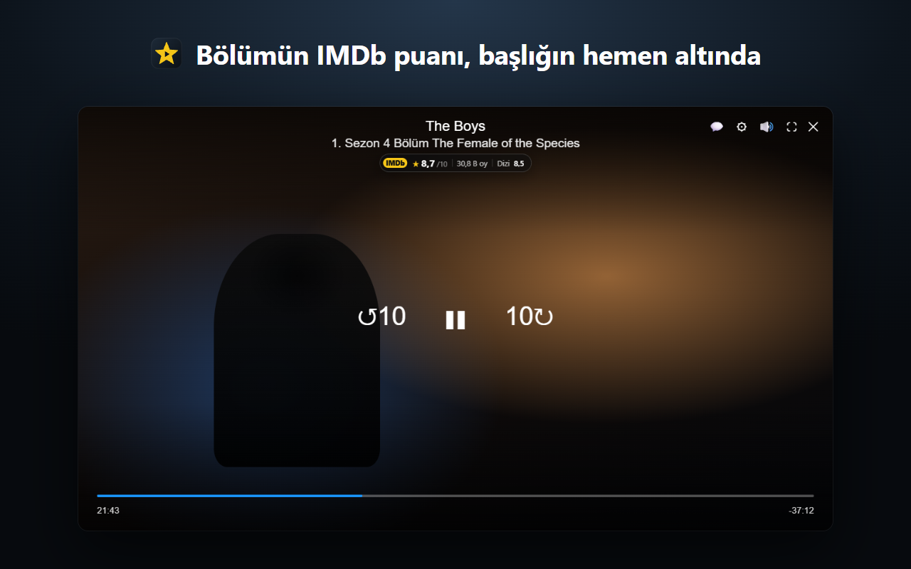
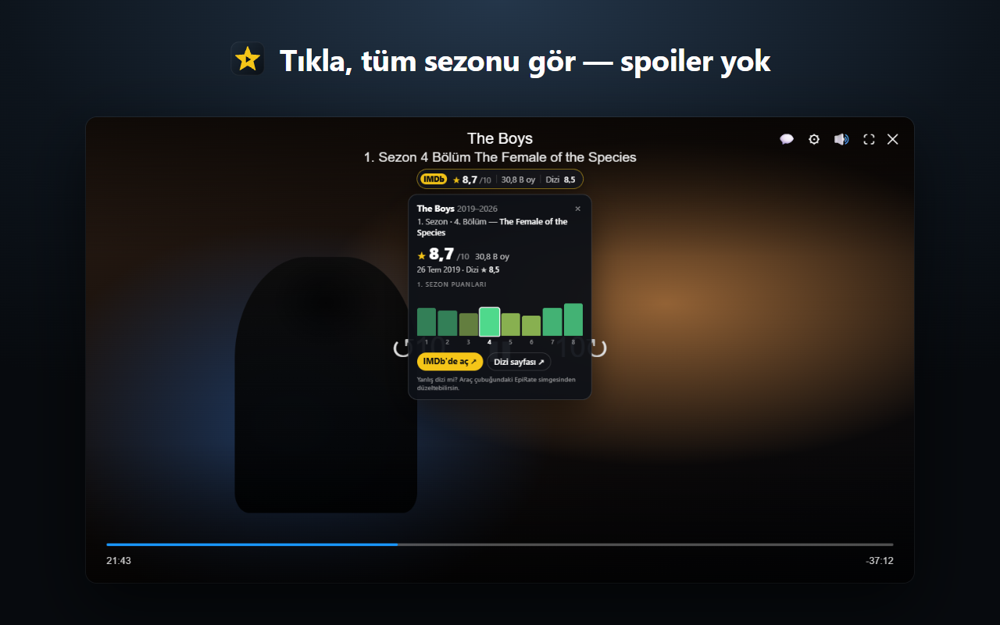
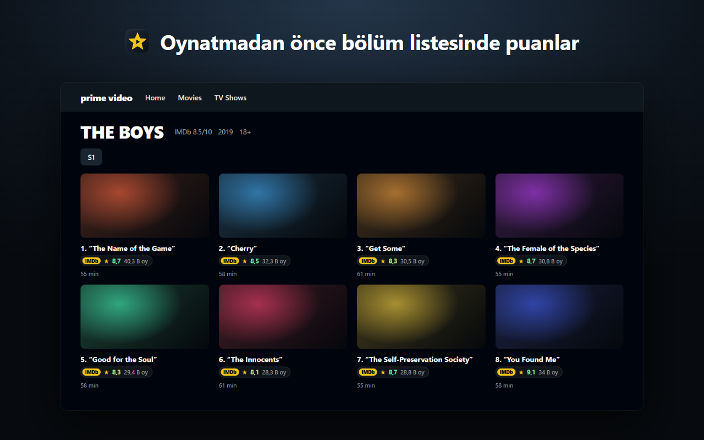

# EpiRate

**İzlerken bölüm puanları.** Prime Video için bir tarayıcı eklentisi; Chrome, Brave, Edge ve diğer Chromium tabanlı tarayıcılarda çalışır.

[English](README.md) · [Gizlilik](PRIVACY.md) · [Hata bildir](https://github.com/Guidin9/epirate/issues)

## Neler yapıyor?

- **Oynatıcıda bölüm puanı:** `★ 8,3/10 · 30,5 B oy · Dizi 8,5`. Prime'ın kendi başlığının altında durur. Kontrollerle birlikte görünüp kaybolduğu için izlerken görüntünün üstünde hiçbir şey kalmaz.
- **Sezonun tamamı tek bakışta:** rozete tıklayınca her bölümün puanını gösteren mini grafik açılır.
  - Sonraki bölümlerin adları gizlidir, yani spoiler yok.
  - "IMDb'de aç" sayfayı arka plan sekmesinde açar; tam ekrandan çıkarmaz.
- **Bölüm listesinde puanlar:** dizi sayfasında her bölümün altında puan ve oy sayısı görünür; oynatmadan önce bakabilirsin.
- **Filmlerde** filmin puanı, **araç çubuğu simgesinde** o anki puan.
- **Akıllı eşleştirme:**
  - Türkçe adla da doğru diziyi bulur ("Yüzüklerin Efendisi: Güç Yüzükleri" → *The Rings of Power*).
  - Aynı adlı dizileri birbirinden ayırır.
  - Yanlış eşleşmeyi iki tıkla düzeltirsin; seçimin hatırlanır.
- **Sana göre:** ne zaman görüneceğini (kontrollerle, bölüm başında ya da hep), konumunu ve boyutunu sen seçersin. <kbd>Alt</kbd>+<kbd>Shift</kbd>+<kbd>I</kbd> ile gizlenir.
- **Diller:** arayüz 12 dilde. Prime'ın bölüm satırını 34 dilde okur.

## Kurulum

- **Chrome Web Store:** yakında.
- **Elle kurulum (geliştirici modu):**
  1. Bu depoyu indir ya da klonla.
  2. `brave://extensions` (Chrome'da `chrome://extensions`) sayfasında **Geliştirici modu**nu aç.
  3. **Paketlenmemiş öğe yükle** → `extension` klasörünü seç.

  Açık bir Prime Video sekmen varsa yenilemene gerek yok; eklenti hemen orada çalışmaya başlar.

## Yol haritası

Gelecek sürümlerde **diğer yayın platformlarına** da destek geliyor.

## Hata bildirimi ve iletişim

- Eklentide: popup'taki **Hata bildir / İletişim** düğmesi. İstersen teknik bilgileri de ekleyerek hazır bir e-posta açar; hiçbir şey otomatik gönderilmez.
- E-posta: [contact@mertdemirdoven.me](mailto:contact@mertdemirdoven.me)
- GitHub: [issues](https://github.com/Guidin9/epirate/issues)

## Gizlilik

Hesap yok, reklam yok, takip yok. EpiRate yalnızca izlediğin içeriğin adını, puanını bulmak için IMDb'ye gönderir ve sonuçları cihazında önbelleğe alır. Ayrıntılar: [PRIVACY.md](PRIVACY.md).

## Bilinen sınırlamalar

- **Gerçek oynatıcı testi:** Prime oynatıcısı giriş ve DRM gerektirdiği için otomatik testlerde onun DOM yapısının birebir kopyası kullanılır. Bu yapı canlı oynatıcı kodundan çıkarıldı. Dizi sayfasındaki bölüm listesi ise gerçek Prime sitesinde test edilir.
- **Farklı numaralandırma:** Prime ile IMDb'nin bölüm numaraları farklıysa (bazı animeler, bölünmüş sezonlar) bölüm bulunamayabilir. Bu durumda dizinin genel puanı gösterilir.
- **Resmi olmayan servis:** IMDb'nin kullanılan servisleri resmi bir API değildir. Değişirse eklenti hata durumunu gösterir.

## Geliştirme

Komutlar ve klasör yapısı için [README.md › Development](README.md#development) bölümüne bak. Mağazaya yükleme adımları: [store/README.md](store/README.md).

## Sorumluluk reddi

EpiRate bağımsız bir projedir; IMDb veya Amazon ile bağlantılı değildir ve onlar tarafından desteklenmez. IMDb ve Prime Video, sahiplerinin ticari markalarıdır. Puan verisi IMDb'den gelir.
